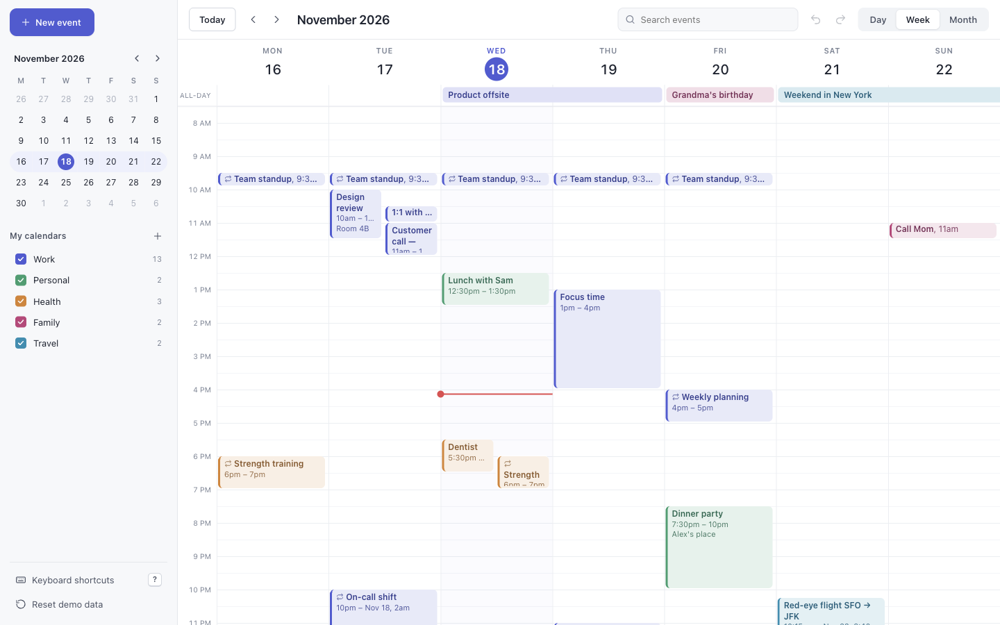
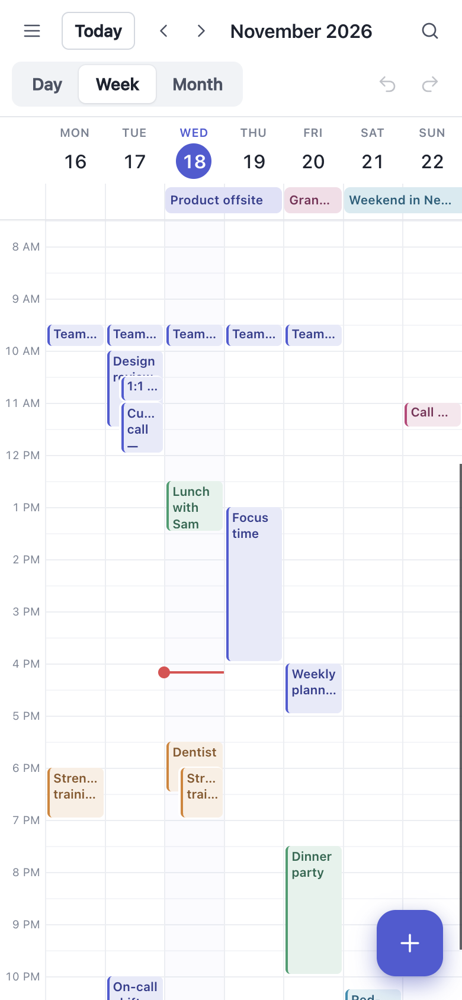

# calander2 — a personal week planner

A polished personal calendar built with **React + TypeScript** (Vite), focused on the weekly view.
Everything runs in the browser; data is stored in `localStorage` and restored on reload.

**Live preview:** https://mucz.github.io/calander2/

| Desktop (1440px) | Mobile (390px) |
| --- | --- |
|  |  |

## Features

- **Week view first** – 24h time grid (30‑min guides), sticky day header, all‑day lane, current‑time line,
  hover slot hints, and side‑by‑side layout for overlapping events (cascaded on narrow screens).
- **Day / Week / Month** views with a mini‑month navigator.
- **Create & edit** – click or drag across empty time to create; click an event to edit title, time,
  all‑day, calendar, location, notes and repeat settings.
- **Drag & drop (desktop)** – move events across time and days, resize from the top/bottom edge,
  move all‑day bars between days, and move events between days in the month view. 15‑minute snapping,
  live ghost preview with times, `Esc` cancels a drag.
- **Touch alternatives (mobile)** – tap an empty slot to create, tap an event to open a bottom sheet with
  large **Move ±15m / ±1 day** and **Duration ±15m** buttons plus native date/time pickers; floating “+” button.
- **Events spanning midnight** – rendered as connected segments on both days (“until 1:30am”).
- **Weekly recurrence** – any set of weekdays with an optional end date. Every change to a recurring
  event (drag, resize, keyboard nudge, edit, delete) asks **“This occurrence only”** vs **“Entire series”**;
  the pending change stays visible as a ghost while you decide.
- **Calendars (categories)** – colour‑coded, toggle visibility, add new ones.
- **Search** – matches title, location, notes and calendar name, lists upcoming occurrences first,
  dims non‑matching events in the grid, keyboard navigable (`↑`/`↓`/`Enter`).
- **Undo / redo** – toolbar buttons, `⌘Z` / `Ctrl+Z`, `⇧⌘Z` / `Ctrl+Y`, and an “Undo” action in every toast.
- **Local persistence** – events, calendars, current view and date survive a page refresh.
- **Keyboard accessible** – see below; dialogs trap focus and restore it, events have descriptive labels.

### Keyboard shortcuts

| Key | Action |
| --- | --- |
| `N` / `C` | New event |
| `T` | Today |
| `D` / `W` / `M` | Day / week / month view |
| `←` `→` (or `J` `K`) | Previous / next period |
| `/` | Search |
| `⌘Z`, `⇧⌘Z` (`Ctrl+Z`, `Ctrl+Y`) | Undo / redo |
| `?` | Shortcut help |
| On a focused event: `Enter` | Edit |
| `↑` `↓` | Move 15 minutes (a week in month view) |
| `←` `→` | Move one day |
| `Shift` + `↑` `↓` | Shorten / lengthen by 15 minutes (`Shift` + `←` `→` for all‑day events) |
| `Delete` / `Backspace` | Delete |

## Demo data

On first load (or via **Reset demo data**) the app seeds the current week with:

- an overlapping cluster (Design review / 1:1 / Customer call) and an overlap with a recurring event,
- events spanning midnight (Overnight release, Red‑eye flight) and a **recurring** midnight‑spanning On‑call shift,
- weekly series (weekday standup, Mon/Wed training, Friday planning),
- single and multi‑day all‑day events, including one that continues into next week.

## Development

```bash
npm ci
npm run dev        # http://localhost:5173
npm test           # unit tests (Vitest)
npm run typecheck
npm run build      # dist/index.html – a single self-contained file
```

The production build inlines JS and CSS into `dist/index.html`, so it can be hosted from any path
(the preview is that file on the `gh-pages` branch).

## Architecture

```
src/
  lib/            pure, framework-free logic (fully unit tested)
    time.ts         "floating" wall-clock time math (DST/timezone independent)
    recurrence.ts   weekly expansion, exceptions, rule comparison
    layout.ts       overlap columns, midnight splitting, all-day lanes
    operations.ts   create / edit / reschedule / delete with "this" vs "series" scope
    history.ts      undo/redo stack
    storage.ts      versioned, validated localStorage persistence
    search.ts       occurrence search
    demo.ts         demo data anchored to the current week
  components/     React UI (WeekView, MonthView, EventEditor, ScopeDialog, Sidebar, …)
tests/            Vitest suites for everything in lib/
```

Times are stored as floating local strings (`YYYY-MM-DDTHH:mm`) and converted to “naive” UTC
milliseconds for arithmetic, so a day is always 24h and 09:00 stays 09:00 across DST changes
(tests run with `TZ=America/New_York` to prove it). Editing a single occurrence adds an exception
date to the series and stores a detached copy linked by `seriesId`; editing the series shifts the
rule (including weekdays) by the same delta.

## Known limitations

- Only weekly recurrence (any weekdays, optional end date); no “this and following” scope.
- No time zones per event, no reminders, sync, sharing or import/export – data lives in this browser only.
- Undo history is kept in memory and resets on reload (the data itself persists).
- Drag & drop is mouse/pen only; on touch devices rescheduling uses the editor’s Move/Duration buttons
  and native pickers instead of long‑press dragging.
- Very dense overlaps on a 390px week view cascade and can truncate titles; the day view is more readable there.
